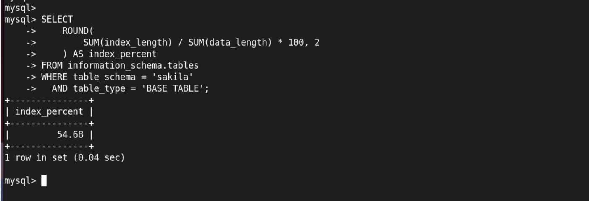
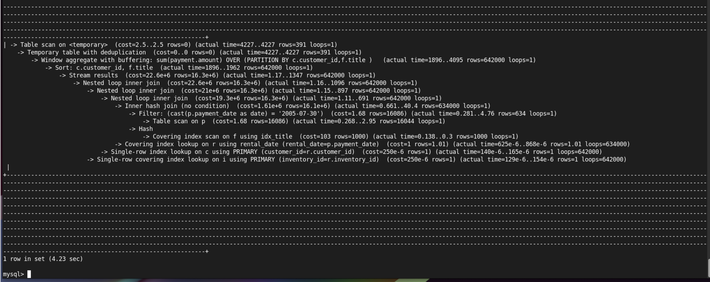
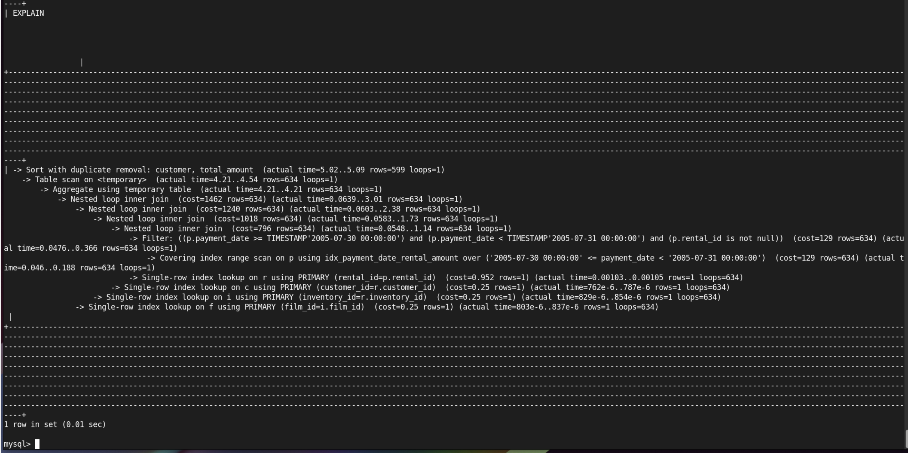

# Домашнее задание к занятию "`Индексы`" - `Насибуллин Михаил`

---

### Задание 1

Напишите запрос к учебной базе данных, который вернёт процентное отношение общего размера всех индексов к общему размеру всех таблиц.<br>

### Ответ



---

### Задание 2

Выполните explain analyze следующего запроса:<br>

```
select distinct concat(c.last_name, ' ', c.first_name), sum(p.amount) over (partition by c.customer_id, f.title)
from payment p, rental r, customer c, inventory i, film f
where date(p.payment_date) = '2005-07-30' and p.payment_date = r.rental_date and r.customer_id = c.customer_id and i.inventory_id = r.inventory_id
```
 - перечислите узкие места;
 - оптимизируйте запрос: внесите корректировки по использованию операторов, при необходимости добавьте индексы.

### Ответ

Результаты EXPLAIN ANALYZE



Главная проблема — отсутствует условие соединения таблиц film и inventory. Из-за этого каждая из 634 записей платежей соединяется со всеми 1000 фильмами, создавая 634 000 промежуточных строк. Также платежи и аренды связываются по совпадению дат вместо rental_id. Использование DATE() мешает эффективно использовать обычный индекс по payment_date. В результате запрос обрабатывает 642 000 строк и выполняется 4,23 секунды.

Оптимизация запроса:
 - Заменим перечисление таблиц через запятую на JOIN для более понятного соединения.
 - Добавим правильную связь между film и inventory.
 - Свяжем платежи и аренды по rental_id.
 - Заменим DATE() на диапазон дат для использования индекса.
 - Заменим оконную функцию на GROUP BY и SUM() для группировки платежей.
 - Создадим составной индекс по payment_date, rental_id и amount для ускорения поиска и обработки платежей.

```
CREATE INDEX idx_payment_date_rental_amount
ON payment (payment_date, rental_id, amount);
```
```

EXPLAIN ANALYZE
SELECT DISTINCT
    CONCAT(c.last_name, ' ', c.first_name) AS customer,
    SUM(p.amount) AS total_amount
FROM payment p
JOIN rental r ON r.rental_id = p.rental_id
JOIN customer c ON c.customer_id = r.customer_id
JOIN inventory i ON i.inventory_id = r.inventory_id
JOIN film f ON f.film_id = i.film_id
WHERE p.payment_date >= '2005-07-30'
  AND p.payment_date < '2005-07-31'
GROUP BY c.customer_id, c.last_name, c.first_name,
         f.film_id, f.title;
```

Результаты EXPLAIN ANALYZE после оптимизации запроса и добавления индекса



После исправления запроса и создания индекса время выполнения сократилось с 4,23 секунды до 5,09 мс. MySQL стал использовать Covering index range scan вместо полного сканирования таблицы payment, обрабатывая при поиске 634 записи вместо 16 044. Ускорение составило около 830 раз.